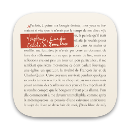
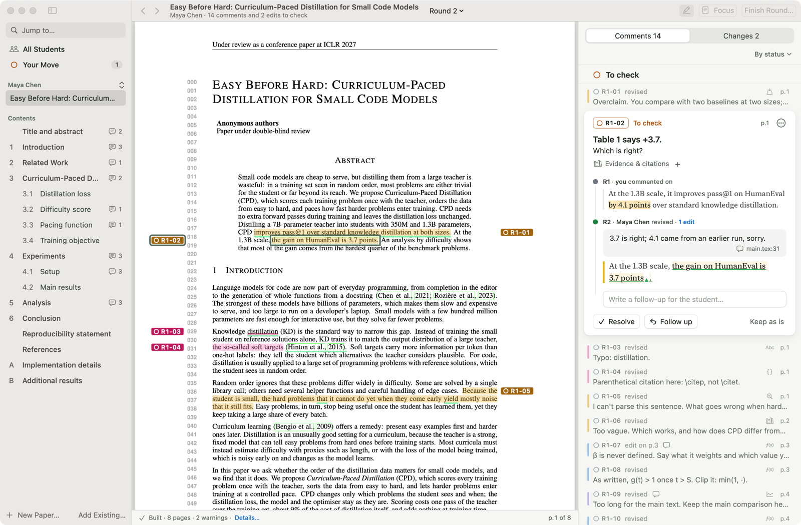
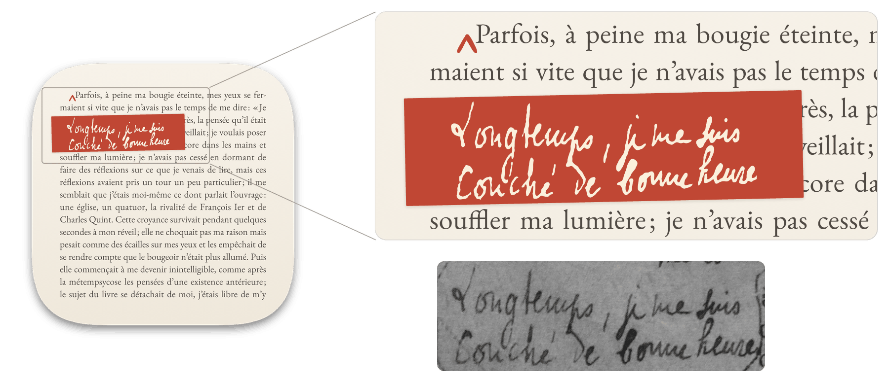
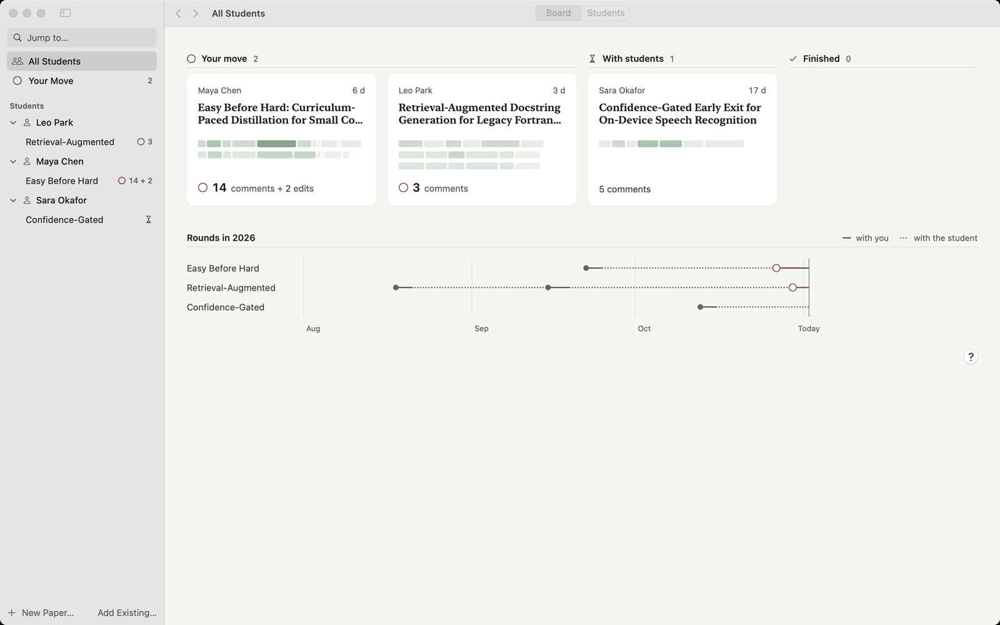
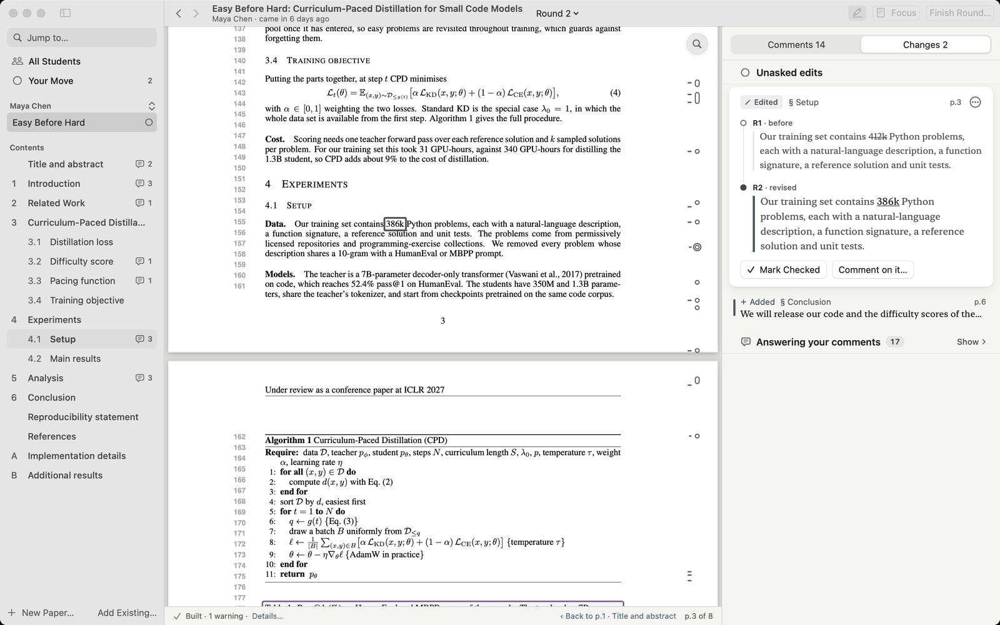
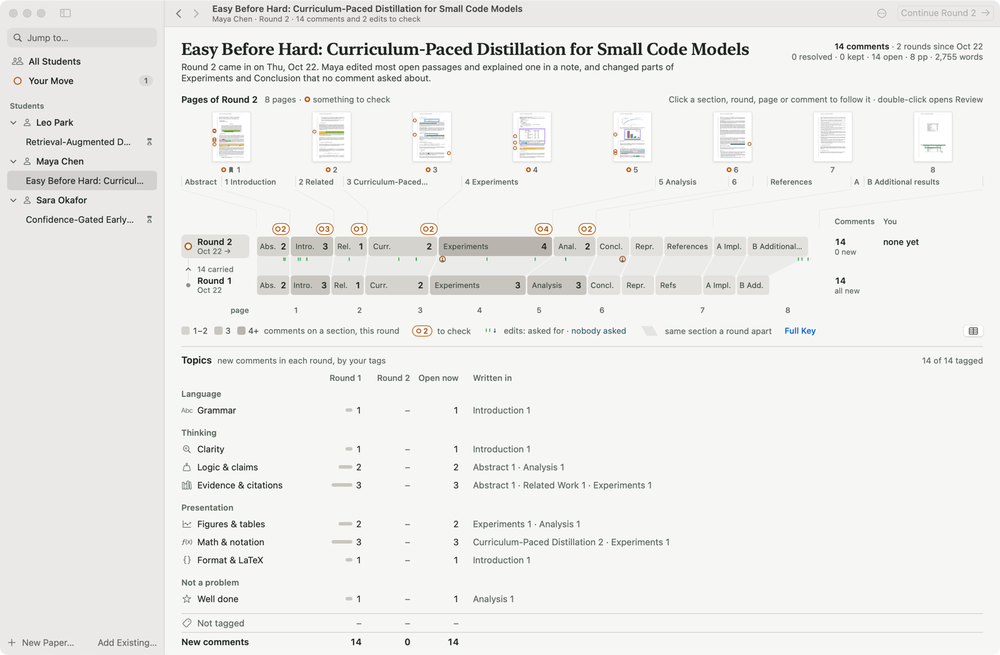
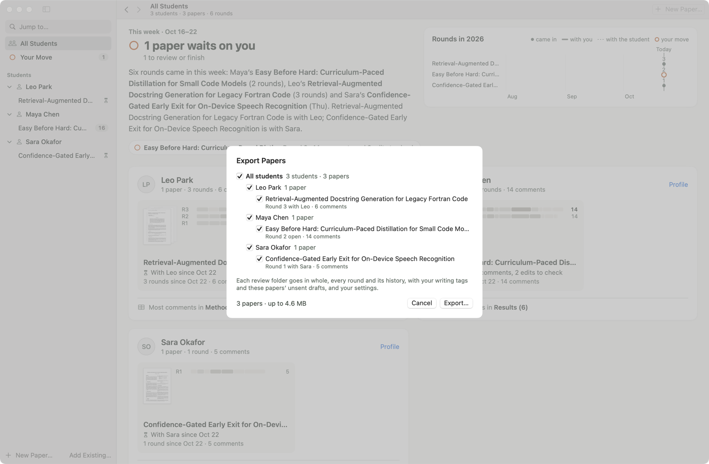
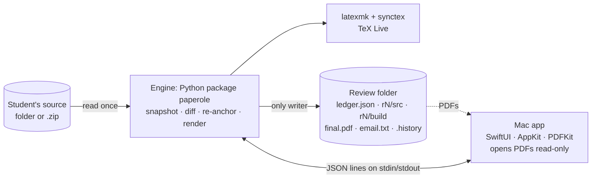

<div align="center">

<picture>
  <source media="(prefers-color-scheme: dark)" srcset="docs/images/icon-dark.png">
  
</picture>

<br>


<p>A Mac app for reviewing LaTeX papers, round by round.</p>

<p>
  
  
  
  <a href="LICENSE"></a>
</p>

<p>
  <a href="#why">Why</a> ·
  <a href="#how-it-works">How it works</a> ·
  <a href="#features">Features</a> ·
  <a href="#getting-started">Getting started</a> ·
  <a href="#architecture">Architecture</a> ·
  <a href="#documentation">Documentation</a>
</p>

<picture>
  <source media="(prefers-color-scheme: dark)" srcset="docs/images/hero-dark.png">
  
</picture>

</div>

## Why

<picture>
  <source media="(prefers-color-scheme: dark)" srcset="docs/images/first-draft-dark.svg">
  
</picture>

<p align="right">
  <em>“<del>All</del> <ins>The</ins> first draft<del>s</del> of <del>every</del><ins>any</ins>thing <del>are</del> <ins>is</ins> <del>garbage</del> <ins>shit</ins>.”</em><br>
  — attributed to Ernest Hemingway
</p>

The typed line is the misquote you find on framed prints, and the vermilion pen fixes it the way an advisor would. Even the fixed line is only *attributed* to Hemingway: its one source is Arnold Samuelson's memoir *With Hemingway* (1984), written fifty years after the talks it recalls. What Hemingway said on the record is quieter. In 1958 [*The Paris Review*](https://www.theparisreview.org/interviews/4825/the-art-of-fiction-no-21-ernest-hemingway) asked him how much he rewrote. The last page of *A Farewell to Arms*, he said, thirty-nine times. And what had stumped him? "**Getting the words right.**"

Students' papers get there the same way, one round at a time. A draft comes in, you mark it up, a revision comes back, and you read it again. Every round, you ask the same three questions: **what changed, where did my comments go, and was each one addressed?** With annotated PDFs alone, you answer them by hand, flipping between two PDFs and rereading your old notes.

Paperole is made for those rounds, from the advisor's side of the desk. You comment on the compiled PDF, and each comment is tied to the LaTeX source behind it. When the next draft arrives, Paperole compiles it, moves every open comment to its new place, shows what the student changed there, and waits for your answer. A comment follows its sentence from draft to draft until the words are right. Students install nothing: they get a PDF with your notes, which you send them yourself.

> [!NOTE]
> Paperole is a personal side project, made for one advisor's way of working and written almost entirely by Claude Code. There are no binary releases, so you build it from source. Please read the [disclaimer](#disclaimer) before you rely on it.

## The name

When the margins of his manuscripts and proofs ran out, Marcel Proust kept writing on strips of paper glued to the page. His housekeeper, Céleste Albaret, called them *paperoles*. A paperole is revision at its most physical: the page isn't right yet, so the missing words are added by hand, right where they belong.

The wordmark at the top sets the name in EB Garamond, with a vermilion caret between the *r* and the *o*. The caret is the proofreader's mark for "insert here", so the name itself reads like a correction.

## The icon

The icon is a page of Proust's *Du côté de chez Swann* (1913). It opens at « Parfois », the novel's second sentence, and a vermilion caret marks where something is missing. Pasted over the text is a paperole with the missing first sentence, « Longtemps, je me suis couché de bonne heure », in Proust's own hand, traced from a photo of the proof he wrote it on.

In the Dock it is just a page with a correction slip. Up close, it is Proust.

<p align="center">
<picture>
  <source media="(prefers-color-scheme: dark)" srcset="docs/images/icon-detail-dark.png">
  
</picture>
</p>

<p align="center"><sub>The icon; its slip, magnified; below, at the same scale, the two lines in Proust's ink on the proof.<br>
Handwriting: Marcel Proust (public domain); traced from a photo by Warburg, Wikimedia Commons, CC BY-SA 3.0. The lower image is a greyscale crop of that photo.</sub></p>

The icon comes in light and dark; **App icon** in Settings › General picks one or follows the system.

## How it works

1. **The student sends you the full source**, as a folder or a .zip.
2. **Paperole takes a read-only snapshot and compiles it** with latexmk.
3. **You comment on the PDF.** SyncTeX ties each comment to the .tex, and each gets an id such as `R1-03`.
4. **Finish Round** writes `final.pdf`, with your comments in the margins, and you send it to the student.
5. **In the next round, Paperole compares the two sources**, moves each open comment to its new place, and attaches the edits under it.
6. **You answer each comment** with **Resolve**, **Follow up** or **Keep as is**, add new ones, and finish the round again.

Only you close a comment; nothing is ever marked done for you. If a student wants to explain an edit, they can leave a LaTeX comment next to it that starts with the comment's id. It doesn't print, and Paperole shows it on the card:

```latex
At the 1.3B scale, the gain on HumanEval is 3.7 points. % R1-02 3.7 is right; 4.1 came from an earlier run, sorry.
```

## Features

**Reviewing**
- Select text and a small toolbar appears: six colours, highlight, underline or strikeout, and **Comment**.
- ⌥-drag (or press B, then drag) to box a figure, table or equation; ⌥-click to place a note.
- Click a mark to open its card. On a new comment's mark, a small toolbar also appears: change its colour or kind, edit the note, or delete it. The colour dot on a card changes colour and kind too. ⌘Z undoes.
- **Find in Paper** (⌘F) searches the PDF as you type, ignoring case and accents. Return and Shift-Return step through the matches, and you can comment on a match like any selection.
- **Jump to…** (⌘K) finds a comment, an edit, a section or a round.
- **Focus** (F) hides the sidebar, enlarges the page and shows one card beside it.

**Across rounds**
- Each open comment follows the source diff to its new place. If the diff can't place it, Paperole looks for the comment's last known text in the new source, first exactly, then approximately (a box can also be found by its `\label`). A comment that still can't be placed is listed as *Not found*, never hidden, and a weak match is labelled "position uncertain".
- The diff works word by word. It ignores re-wrapped lines and edits inside `%` comments, and it notices moved text.
- A card reads like a conversation, one turn per round. Each turn shows the sentence as that round's PDF printed it, with the changed words underlined. Figures, tables and equations appear as crops of each round's PDF.
- The **Changes** tab lists every edit since the last round. You go through the ones no comment asked for: **Mark Checked** or **Comment on it…**.
- Earlier rounds open read-only from the round menu. **Reopen in Round N** brings back a comment you closed in an earlier round.

**Finishing a round**
- One sheet shows what goes to the student, what is still to check, any follow-ups not yet sent, and the round's card so far.
- **Finish Round** writes `final.pdf` and closes the round. You send `final.pdf` yourself; Paperole never sends mail. It does write a draft email, `email.txt`, which you can copy from the toolbar's **final.pdf** menu.
- The sheet then turns into the **round's card**: how much you wrote, the topics by tag, where your marks fell on the pages, how earlier comments were answered, and a fact or two. **Copy Image** and **Export Image…** save it as a PNG 1080 pixels wide; the paper's title and the student's name appear only if you tick them. **Round N Summary…** in the round menu shows the card again later.
- `final.pdf` starts with summary pages: how to reply, the to-do ids, comments by status, and edits nobody asked for. Then comes the paper with wider margins, your marks and notes drawn into the page itself rather than added as PDF annotations, and an outline that links to each comment.

**The overview**
- **All Students** shows this week's rounds, a timeline of the year and a card for each student. **Your Move** lists the papers waiting on you.
- Each paper has a **paper map**: its rounds by section, where comments and edits fall, and where each comment went from round to round.
- Each student has a page with their papers, where your comments on them land, and how many days each round trip took, theirs and yours.

**Writing tags**
- Ten built-in tags (Grammar, Wording, Clarity, Logic & claims, Evidence & citations, Structure, Figures & tables, Math & notation, Format & LaTeX, Well done), plus your own.
- Paperole suggests tags from the words in your note, using simple rules that run on your Mac; a suggestion counts only once you click it. Tags are counted per round and can group or filter the comment list. Students never see them.

**Your data** stays on your Mac, in one self-contained review folder per paper. See [Your data](#your-data).

<table>
  <tr>
    <td width="50%">
      <picture>
        <source media="(prefers-color-scheme: dark)" srcset="docs/images/overview-dark.png">
        
      </picture>
      <p align="center"><sub>All Students: what waits on you</sub></p>
    </td>
    <td width="50%">
      <picture>
        <source media="(prefers-color-scheme: dark)" srcset="docs/images/changes-dark.png">
        
      </picture>
      <p align="center"><sub>Changes: an edit nobody asked for</sub></p>
    </td>
  </tr>
  <tr>
    <td width="50%">
      <picture>
        <source media="(prefers-color-scheme: dark)" srcset="docs/images/paper-map-dark.png">
        
      </picture>
      <p align="center"><sub>The paper map</sub></p>
    </td>
    <td width="50%">
      <picture>
        <source media="(prefers-color-scheme: dark)" srcset="docs/images/export-dark.png">
        
      </picture>
      <p align="center"><sub>Export: one checked .zip</sub></p>
    </td>
  </tr>
</table>

<sub>The screenshots show synthetic demo papers from <a href="samples/promo-demo/ISSUES.md"><code>samples/promo-demo</code></a>; the people are made up.</sub>

## Limitations

- **Mac only, advisor only.** There is no student app or web page, and students reply only through `% R1-03` notes. There is no second reviewer, no sync, and no iPad, Windows or Linux version.
- **It needs a local TeX Live** at `/Library/TeX/texbin` (the path is hard-coded). LaTeX runs with `-no-shell-escape`, so packages that need shell escape, such as minted, won't build.
- **Tested templates:** acmart (sigconf, acmsmall), ACL, ICLR, ICML 2026 (submission and accepted) and NeurIPS 2026 (submission and final), each over three synthetic rounds; all 253 carried comments ended up in the right state. IEEE, LNCS, Elsevier and REVTeX are untested.
- **Only pdflatex has been tried for real.** xelatex and lualatex are wired in but untested. A `% !TEX program = …` line picks them, and xelatex is also picked for papers that use fontspec, xeCJK, polyglossia or unicode-math.
- **Known rough edges**:
  - formulas and figures quoted in the email come out garbled;
  - widened `final.pdf` pages print at about 75%;
  - a carried box may not fit a resized figure or equation;
  - a drag that starts on a citation link selects nothing;
  - a student note can pick up an unrelated edit within three lines;
  - Increase Contrast is not supported;
  - pages with `/Rotate` are not supported.

## Requirements

- **macOS 14 or later.** Developed on macOS 15 on Apple silicon.
- **Xcode 16**, the full app, not just the Command Line Tools (`build_app.sh` needs `actool`).
- **Python 3.9 or later** with PyMuPDF 1.24 or later (developed with 1.26.5), and pytest for the tests.
- **MacTeX / TeX Live** in `/Library/TeX/texbin`, with `latexmk` and `synctex`.

## Getting started

> [!NOTE]
> The app was called PaperCollab until October 2026. If your Mac ran PaperCollab, Paperole moves its data over the first time it opens, and PaperCollab's exports and backups open in Paperole ([mac/UX.md](mac/UX.md) §34).

These commands work in zsh, bash and fish. Run them from the repository root unless a step says otherwise.

```sh
git clone git@github.com:FeiSun/Paperole.git
cd paperole

# 1. The engine: a virtualenv at engine/.venv (the app and scripts expect this path)
cd engine
python3 -m venv .venv
.venv/bin/pip install --upgrade pip      # macOS's own python3 ships a pip too old for -e
.venv/bin/pip install -e . pytest
cd ..

# 2. The app: builds it and installs /Applications/Paperole.app (ad-hoc signed)
mac/release.sh

# 3. Run it
open -a Paperole
```

The app runs the engine with `engine/.venv/bin/python` from the checkout it was built from, so the clone can live anywhere. It also carries its own copy of the engine, so run `mac/release.sh` again after you change the engine or move the checkout. To use a different Python, see [mac/README.md](mac/README.md).

### Try it with the demo papers

`samples/promo-demo` holds three synthetic papers, and one script builds their review folders through the engine. It takes about half a minute, and the output folder must not exist yet.

```sh
engine/.venv/bin/python -I samples/promo-demo/tools/build_reviews.py ~/Paperole-demo
open -n -a Paperole --args --paper ~/Paperole-demo/review \
    --paper ~/Paperole-demo/others/leo-park/review --paper ~/Paperole-demo/others/sara-okafor/review
```

You get Maya Chen's paper with round 2 open, Leo Park's with round 3 open, and Sara Okafor's with round 1 finished. Papers opened with `--paper` are not saved to the app's list; to keep them, use **Add Existing…** at the bottom of the sidebar.

## Using Paperole

**The first round**

1. Click **New Paper…** at the bottom of the sidebar and enter the title and the student's name. The review folder is named after the title and goes in `~/Reviews`, unless you **Choose…** another empty folder. It is never the student's source folder.
2. Click **Start Round 1…** and choose the student's LaTeX folder or .zip. Paperole copies and compiles it, and the line under the PDF shows how the build went, for example "Built · 8 pages · 2 warnings".
3. Select text in the PDF, click **Comment** in the toolbar that appears, write your note and save it.
4. Click **Finish Round…**, look over the sheet, then click **Finish Round**. The sheet turns into the round's card. Send `final.pdf` to the student; **Show in Finder** in the sheet, or the toolbar's **final.pdf** button, takes you to it.

**The rounds after**

1. When the revision arrives, click **New Round…** and choose the new folder or .zip.
2. On the **Comments** tab, the carried comments wait under **To check**. Each card shows what you wrote, what the student did, and the changed words underlined. Click **Resolve** or **Keep as is**, or type in the card's field and click **Follow up**. The panel moves on to the next card, and ⌘Z undoes an answer.
3. On the **Changes** tab, go through the edits no comment asked for.
4. Add new comments, then click **Finish Round…** again. The first pages of `final.pdf` list the follow-ups, the comments still open, the new comments and the closed ones.

Keys are optional: V resolves, W keeps as is, R jumps to the follow-up field, J and K move between cards, and ⌘F finds words in the PDF. The full keyboard map is in [mac/UX.md](mac/UX.md) §9.

## Your data

- **Local only.** No account, no sync, no uploads, no mail. Paperole has no network code.
- **The student's folder is read once**, into a read-only snapshot, and never written to.
- **The engine is the only writer** of the ledger and of every PDF. Writes are atomic, and each finished round gets a SHA-256 manifest.
- **Ledger history.** Earlier versions of the ledger are kept in `.history/`: one at each new round, each Finish and each Reopen, and more as you work. **Put Back an Earlier Ledger…** in a paper's context menu restores one as a new version.
- **Export… and Import…** (File menu, or Settings › Data & Storage):
  - export writes one .zip and checks every file in it against its checksum;
  - import shows a preview first and never overwrites: anything it replaces goes to "Replaced by Import".
- **Comments** export as CSV or JSON (**Export Comments** in a paper's or a student's context menu).
- **Backups** are off by default. Turned on, they run daily and after each Finish Round, and old ones are rotated out. Either way, a read-only check of every listed paper runs once a day.

<details>
<summary>The review folder, one per paper</summary>

```text
<review folder>/
├── ledger.json              the authoritative record: comments, verdicts, rounds
├── .lock
├── .history/                earlier versions of ledger.json
└── r1/, r2/, …
    ├── src/                 read-only snapshot of the student's source
    ├── build/               latexmk output: <main>.pdf, .synctex.gz, .log, aux files
    ├── analysis.json        what changed since the round before (round 2 on)
    ├── prose.json           the round's paragraphs
    ├── final.pdf            written by Finish Round
    ├── email.txt            written by Finish Round
    └── manifest-sha256.txt  checksums, written by Finish Round
```

The full description is in [engine/CONTRACT.md](engine/CONTRACT.md) §2 and its amendments.

</details>

## Architecture



- **The app** ([`mac/`](mac/)) is a Swift package. It shows the PDF with PDFKit, draws marks in an overlay, and never saves a PDF.
- **The engine** ([`engine/`](engine/)) is a Python package that needs only PyMuPDF and the standard library. The app starts it as `python -m paperole.cli rpc` and sends one JSON request per line; replies come back by id, with progress events while a request runs. Requests run one at a time. A second engine process fills in older rounds for the overview, and another runs backups and the daily check.
- **Almost every RPC method has a matching CLI command**, so anything the app does can be scripted and tested from the shell.
- **The ground rules:** the engine is the only writer of `ledger.json`, `analysis.json` and every PDF; nothing writes into the student's folder; only the advisor closes a comment.

<details>
<summary>The engine from the command line</summary>

Run from `engine/`, on the synthetic test paper in `engine/tests/fixtures/paper` (delete `~/engine-demo` afterwards). Every command prints the paper's state as JSON.

```sh
.venv/bin/python -m paperole new ~/engine-demo --title "Predictive Warm Pools" --student "Lin Zhou"
.venv/bin/python -m paperole ingest ~/engine-demo tests/fixtures/paper/v1     # snapshot and compile round 1
.venv/bin/python -m paperole comment ~/engine-demo --page 0 --rects "184.37,391.04,288.37,401.0" \
    --text "simple keep-alive policy" --note "Not accurate: it is a static policy."   # R1-01
.venv/bin/python -m paperole finish ~/engine-demo                             # r1/final.pdf and r1/email.txt
.venv/bin/python -m paperole ingest ~/engine-demo tests/fixtures/paper/v2     # compare and carry R1-01
.venv/bin/python -m paperole verdict ~/engine-demo R1-01 verified             # Resolve
.venv/bin/python -m paperole state ~/engine-demo
```

Other subcommands: `tag`, `retag`, `revive`, `edit`, `reanchor`, `delete`, `check`, `import`, `prose`, `read`, `email-preview`, `summaries`, `overview`, `export`, `edit-paper`, `fork`, `history`, `put-back`, `check-folder`, `archive-write`, `archive-check`, `archive-unpack`, `swap-in`, `rpc`. See `.venv/bin/python -m paperole --help`, [engine/README.md](engine/README.md) and [engine/CONTRACT.md](engine/CONTRACT.md).

</details>

## Repository layout

`<repo>` is the root of your checkout, whatever its folder is called.

```text
<repo>/
├── mac/                     the Mac app (Swift package)
│   ├── Sources/Paperole/    the app's code
│   ├── Tests/               unit tests (swift test)
│   ├── Fixtures/            synthetic states and PDFs for tests and --fixture runs
│   ├── tools/               shot.sh (captures one test instance's window), Dev icon
│   ├── build_app.sh         builds a development copy for testing
│   ├── release.sh           builds and installs the app
│   └── UX.md                interaction spec
├── engine/                  the engine (Python package paperole)
│   ├── paperole/            project, texdiff, anchor, notes, cards, render, ledger, archive, …
│   ├── tests/               pytest suite, with a synthetic three-round test paper
│   └── CONTRACT.md          the engine ↔ app contract
├── samples/promo-demo/      synthetic demo papers and the script that builds their reviews
├── design/brand/paperole/hand/  the traced handwriting the icon is made from
└── docs/images/             README images
```

## Development

**Tests.** There is no CI, so run both suites before you commit.

```sh
cd engine
.venv/bin/python -m pytest      # engine tests; the LaTeX ones are skipped without latexmk
cd ../mac
swift test                      # app unit tests
cd ..
```

**Testing without disturbing a running copy.** `mac/build_app.sh` builds a development copy, "Paperole Dev", with its own list of papers and its own settings. Test with it, on copies of review folders. A background run never takes focus, has no Dock icon and saves no settings:

```sh
open -g -n "mac/build/Paperole Dev.app" --args --background --no-list --paper /path/to/copy-of-review-folder
pgrep -n -f 'Paperole Dev.app/Contents/MacOS/PaperoleDev --background'   # prints its PID, say 12345
mac/tools/shot.sh --pid 12345 shot.png    # captures that instance's window only
kill -TERM 12345                          # quits that instance only
```

Don't use `pkill`, `killall` or an AppleScript `quit` for this: they can close a window someone is working in.

**Driving the app from a script.** `--debug-script "…"` runs clicks, drags, keys and typing inside the app and writes the results as JSON to `--debug-out`; no Accessibility permission is needed. `--fixture` shows a saved state without an engine and saves nothing. Give the app absolute paths, because `open` starts it in `/`:

```sh
open -n "mac/build/Paperole Dev.app" --args --fixture "$PWD/mac/Fixtures/state-m2a.json"
```

All launch arguments and script items are listed in [mac/README.md](mac/README.md) and [mac/UX.md](mac/UX.md) §13.

**Conventions**
- Design comes first: interaction in [mac/UX.md](mac/UX.md), names and formats in [engine/CONTRACT.md](engine/CONTRACT.md).
- The UI, PDFs and emails are in English.
- Students' real papers never go into the repository, its tests or its fixtures.

## Documentation

| Document | What it covers | Language |
|---|---|---|
| [mac/UX.md](mac/UX.md) | The app's interaction spec, §1–§34 | English |
| [mac/README.md](mac/README.md) | Building, launch arguments, debug hooks, the engine path | English |
| [engine/CONTRACT.md](engine/CONTRACT.md) | Review folder, ledger, CLI/RPC methods, state JSON, final PDF and email | English |
| [engine/README.md](engine/README.md) | Engine setup, CLI reference, a three-round walk-through | English |
| [design/brand/paperole/hand/SOURCE.md](design/brand/paperole/hand/SOURCE.md) | Source and licence of the traced handwriting in the icon | English |

## Roadmap

Open items:

- Annotating elsewhere: mark up the review PDF on an iPad or in another PDF app, then import it. Today import works only from the command line.
- More templates (IEEE, LNCS, Elsevier, REVTeX), and tested xelatex and lualatex builds.
- An official app that bundles its own Python and PyMuPDF instead of using the repository's venv.
- Increase Contrast support and smaller interface fixes.
- On hold: student replies pasted from email. For now, students answer through `% R1-03` notes.

## Acknowledgements

Paperole was partly inspired by **[Paper Pal](https://github.com/Claire1217/paper-pal)** by claire1217 (MIT licence), a local app in which an author reviews AI edits to a LaTeX paper. Paper Pal lets an author review the AI; Paperole lets an advisor review a student. Three ideas came from it:

- **Reading tied to content.** Read state is kept per paragraph, by a hash of its text, so a paragraph the student edits becomes unread again. This drives the optional reading marks: the bars in the PDF's margin and the dot after a section in Contents.
- **Exact source ranges for each paragraph.** The engine keeps each paragraph's exact range in the .tex. The block rules and the text-command table in [`engine/paperole/prose.py`](engine/paperole/prose.py) follow the design of Paper Pal's `parseBlocks` and `TEXT_COMMANDS`. They were written in Python from a description of that design; no code was copied.
- **The review layout:** contents with progress on the left, the paper in the middle, cards on the right.

Design ideas from other tools:

- **Rounds and verdicts** follow code review in GitHub, GitLab, Gerrit, Phabricator and Reviewable: a comment is a thread, a round goes out as one batch, a comment stays put and is flagged when the text under it changes, and nothing is resolved or hidden automatically. *Resolve* is the word GitHub, GitLab, Gerrit, Word, Google Docs and Overleaf use.
- **Cards and lists:** the note as the card's title (GitHub, Linear, Figma), unchanged rounds folded away (GitHub Primer, Linear), group headers (Linear, GitHub, Things, Reminders), notes placed at a point (Preview, Acrobat).
- **Visual design:** *PaperCollab Calm*, a design study made with Codex, gave the three panes, the Sage accent, Focus, ⌘K Jump and the quieter queue, most of them since reworked. Smaller touches came from other Mac apps, among them Linear, Things 3, Superhuman, Skim, Readwise Reader, Ulysses, iA Writer, Mail and Xcode's Open Quickly. The colour rules follow Apple's Human Interface Guidelines and IBM Carbon, and the status chips follow GitHub Primer.
- **The overview:** the paper map's bands that join a section across rounds come from IBM's history flow (Viégas, Wattenberg and Dave, CHI 2004), the key page from Photos' key photo and Time Machine's stack of versions, and Your Move from Mail's smart mailboxes.

The name, the icon and the story above borrow from the works below.

- **Marcel Proust's handwriting** (public domain), from the photo ["Autographe Proust longtemps.JPG"](https://commons.wikimedia.org/wiki/File:Autographe_Proust_longtemps.JPG) by Warburg, Wikimedia Commons, [CC BY-SA 3.0](https://creativecommons.org/licenses/by-sa/3.0/). The traced paths in [`design/brand/paperole/hand/`](design/brand/paperole/hand/) are shared under [CC BY-SA 4.0](https://creativecommons.org/licenses/by-sa/4.0/), and the icon is an adaptation of them. Wherever the icon is shown or shipped, it carries this credit ([SOURCE.md](design/brand/paperole/hand/SOURCE.md)): "Handwriting: Marcel Proust (public domain); traced from a photo by Warburg, Wikimedia Commons, CC BY-SA 3.0".
- **The text of *Du côté de chez Swann*** on the icon's page, from [Project Gutenberg eBook #2650](https://www.gutenberg.org/ebooks/2650) (public domain).
- **EB Garamond** (SIL Open Font License 1.1), from TeX Live, for the icon's page, the wordmark and the attribution in the first-draft animation, and **TeX Gyre Cursor** (GUST Font License) for its typed line. Both are outlined into the images.
- **Hemingway.** "The first draft of anything is shit" is only attributed to him: its single source is Arnold Samuelson's memoir *With Hemingway: A Year in Key West and Cuba* (1984), and [Quote Investigator](https://quoteinvestigator.com/2015/09/20/draft/) weighs the evidence. "Getting the words right" is on the record, in George Plimpton's interview "Ernest Hemingway, The Art of Fiction No. 21", [*The Paris Review*](https://www.theparisreview.org/interviews/4825/the-art-of-fiction-no-21-ernest-hemingway) 18 (Spring 1958).

Built with:

- **[PyMuPDF](https://pymupdf.readthedocs.io/)** and MuPDF from Artifex (AGPL-3.0, or a commercial licence), the engine's only third-party dependency: it reads the PDF's words and writes `final.pdf`.
- **TeX Live**, with **latexmk** and **SyncTeX**, which build each round and tie the PDF to the source.
- Apple's SwiftUI, AppKit and PDFKit, SF Symbols, and the SF Pro and New York fonts.
- **[Claude Code](https://claude.com/claude-code)**, which wrote nearly all of the code, its tests and most of its documentation, with a little help from other AI tools. See the [disclaimer](#disclaimer).

## License

GPL-3.0. See [LICENSE](LICENSE).

The traced handwriting in [`design/brand/paperole/hand/`](design/brand/paperole/hand/) is CC BY-SA 4.0, which is one-way compatible with GPLv3; anything made from it, the icon included, needs the credit above. [`docs/images/icon-detail.png`](docs/images/icon-detail.png) and its dark twin contain a greyscale crop of Warburg's photo (CC BY-SA 3.0) and are shared under CC BY-SA 4.0.

## Disclaimer

Paperole is a side project, made outside my research job for one selfish reason: marking up my students' papers, round after round, should take less clicking and less digging through old PDFs. It gets attention when I need it and rests when I don't. There is no promise of long-term maintenance, no release plan and no support.

It was also built almost entirely by AI. I don't do Mac development, and I have read very little of the code that matters. [Claude Code](https://claude.com/claude-code) wrote it, tested it and reviewed it, with other AI tools lending a hand now and then. My part was the itch, the ideas, the design, and a great many rounds of "no, not quite", which seems fitting for an app about getting the words right. So the credit for the code goes mostly to Claude Code; the design and the ideas, faults included, are mine.

What that means for you:

- **No guarantees.** It works for me, on my Mac, with my students' papers, and it has a decent pile of tests, but nobody has audited it. Use it at your own risk.
- **Keep backups.** Paperole can make them for you (off by default; Settings › Data & Storage), and it never writes into a student's source folder, but a copy of anything you care about is still a good idea.
- **Issues and ideas are welcome.** Answers may be slow, or may come from Claude.
